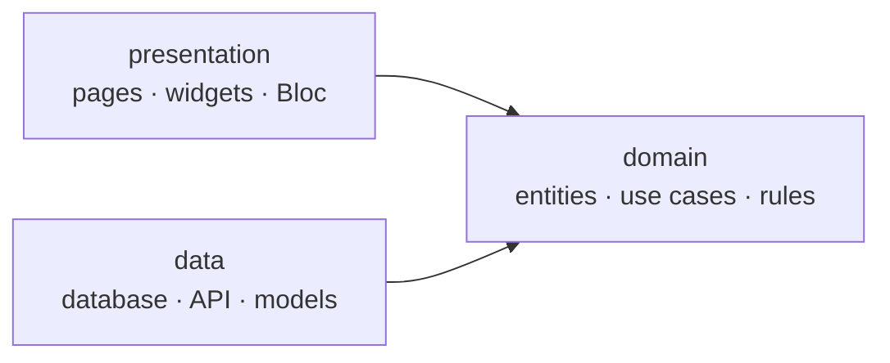
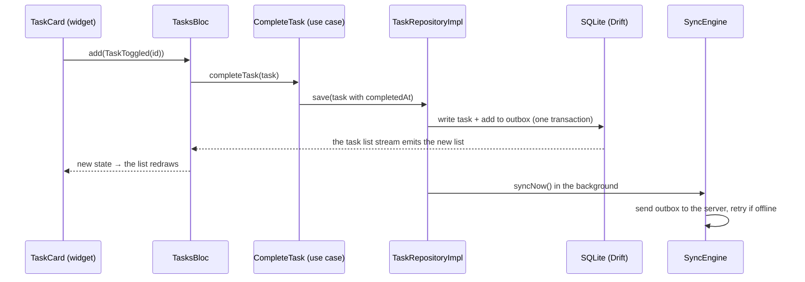

# Daybook

Daybook is a personal organizer built with Flutter: **tasks**, a **calendar**, and (soon) habits, expenses and more.

It's also a learning project. Every part was built one small step at a time, so the code doubles as a reference for how a real Flutter app fits together. This README explains the architecture in plain words and lists every Flutter and Dart concept used, with a link to where you can see it in the code.

---

## Contents

1. [What works today](#what-works-today)
2. [Run it](#run-it)
3. [The architecture in 5 minutes](#the-architecture-in-5-minutes)
4. [How the main pieces work](#how-the-main-pieces-work)
5. [Concepts learned and where to find them](#concepts-learned-and-where-to-find-them)
6. [Tests](#tests)
7. [Roadmap](#roadmap)

---

## What works today

| Area | What you can do |
| --- | --- |
| **Account** | Register, log in, stay logged in after restarting, log out. Expired sessions refresh on their own. |
| **Tasks** | Create, edit, complete, delete (with Undo) and reorder tasks. Subtasks, due dates, priorities and repeating tasks. Search, filter and sort. |
| **Offline** | Tasks and events work with no internet. Changes wait in a queue and sync when you're back online. |
| **Calendar** | Month, week, day and agenda views. Repeating events. Drag an event to a new time. Turn a task into an event. |
| **Developer tools** | (Debug builds) Slow the server down, make it fail on purpose, go "offline", or edit a task "on another device". |

There is **no real backend yet**. The app talks to a fake server that lives inside the app (see [Mock API](#4-the-mock-api)), so requests, status codes and JSON are all real.

---

## Run it

```bash
flutter pub get
flutter run
```

Log in with the demo account: **demo@daybook.dev** / **password123** (debug builds have a "Use demo account" button).

| Command | What it does |
| --- | --- |
| `flutter test` | Run all tests |
| `flutter analyze` | Check code style and types |
| `dart run build_runner build --delete-conflicting-outputs` | Regenerate the `.g.dart` files after changing a model or a database table |
| `flutter run --dart-define=ENV=real --dart-define=API_URL=https://...` | Use a real API instead of the mock |

Debug builds use the mock server by default and release builds use the real API. `ENV` overrides that.

---

## The architecture in 5 minutes

### The big idea: three layers per feature

Each feature (auth, tasks, calendar…) lives in its own folder and is split into three layers:

```
features/tasks/
├── domain/        What a task IS and the rules about it. Pure Dart, no Flutter.
├── data/          Where tasks are stored and fetched: database, network, JSON.
└── presentation/  What you see: pages, widgets, and the Bloc that drives them.
```



**The one rule:** arrows point *inward*, to `domain`. The domain never imports Flutter, Dio or Drift. That keeps the rules easy to test and means you can swap the database or the API without touching the screens.

### What each layer contains

| Layer | Contains | Example |
| --- | --- | --- |
| **domain** | **Entities**: plain classes for your data | [`Task`](lib/features/tasks/domain/entities/task.dart) |
| | **Repository contracts**: *what* data operations exist, not *how* | [`TaskRepository`](lib/features/tasks/domain/repositories/task_repository.dart) |
| | **Use cases**: one action each, like "complete a task" | [`CompleteTask`](lib/features/tasks/domain/usecases/complete_task.dart) |
| | **Services**: pure logic, like "when does this repeat next?" | [`TaskQuery`](lib/features/tasks/domain/services/task_query.dart) |
| **data** | **Models**: turn JSON into entities and back | [`TaskModel`](lib/features/tasks/data/models/task_model.dart) |
| | **Data sources**: talk to one thing (database or API) | [`TaskLocalDataSource`](lib/features/tasks/data/datasources/task_local_data_source.dart) |
| | **Repository implementations**: the *how* behind the contract | [`TaskRepositoryImpl`](lib/features/tasks/data/repositories/task_repository_impl.dart) |
| **presentation** | **Bloc / Cubit**: holds screen state, reacts to user actions | [`TasksBloc`](lib/features/tasks/presentation/bloc/tasks_bloc.dart) |
| | **Pages and widgets**: draw the state | [`TasksPage`](lib/features/tasks/presentation/pages/tasks.dart) |

### Shared code

```
lib/
├── main.dart          Starts the app: sets up dependencies, then runApp()
├── app.dart           The root widget: theme + router
├── core/              App-wide plumbing, used by every feature
│   ├── di/            Dependency injection (who creates what)
│   ├── error/         Exceptions, Failures, and the mapper between them
│   ├── network/       ApiClient, interceptors, and the mock server
│   ├── routing/       All routes, the tab shell, the login redirect
│   ├── storage/       The SQLite database, secure token storage, the outbox
│   ├── sync/          The engine that syncs local changes with the server
│   ├── theme/         Colors, spacing, radius, text styles
│   └── utils/         Result<T>, validators, id generator
├── shared/            Reusable building blocks
│   ├── widgets/       AppButton, AppTextField, AppCard, loading/empty/error states…
│   ├── models/        Things several features use, like RecurrenceRule
│   ├── services/      Shared logic, like RecurrenceCalculator
│   └── extensions/    Handy additions, like context.colors and date.startOfWeek
└── features/          auth · tasks · calendar · dashboard · habits · settings
```

### Following one tap through the app

Here's what happens when you tick a task as done:



Notice the screen updates from the **database**, not from the server. That's why the app feels instant and works offline.

### State management: one approach per feature, on purpose

Different features use different tools so you can compare them:

| Feature | Tool | Why it fits |
| --- | --- | --- |
| Auth, Tasks | **Bloc** (events in, states out) | Many kinds of user actions; named events make them easy to follow and test |
| Calendar | **Cubit** (methods in, states out) | Simpler: `cubit.next()` instead of `add(NextPressed())` |
| Small UI bits (a form, a toggle) | **setState** | State that only one widget cares about |

Coming later: Habits and Expenses (Cubit), Settings (ChangeNotifier), Chat (Riverpod).

---

## How the main pieces work

### 1. Errors: `Result<T>` instead of throwing

Low-level code (network, database) **throws** an exception. The repository **catches** it and **returns** a `Result`, either `Success(data)` or `Err(failure)`. Screens only ever see a friendly `Failure`, never a crash.

```dart
final result = await login(email: email, password: password);
final message = result.fold(
  (user) => 'Hello ${user.name}',
  (failure) => failure.message,   // e.g. "Wrong email or password"
);
```

Files: [`exceptions.dart`](lib/core/error/exceptions.dart) → [`error_mapper.dart`](lib/core/error/error_mapper.dart) → [`failures.dart`](lib/core/error/failures.dart), [`result.dart`](lib/core/utils/result.dart).

### 2. Dependency injection (GetIt)

Classes **ask** for what they need in their constructor instead of creating it. One file, [`injection.dart`](lib/core/di/injection.dart), registers how to build everything at startup. It's like a phone book: register once, look up by type.

- `registerLazySingleton`: one shared instance (Dio, database, repositories).
- `registerFactory`: a new one each time (a screen's Bloc).

Only `main.dart`, `app.dart`, `injection.dart` and `app_router.dart` use `getIt`. Everything else gets its dependencies through the constructor, which is what makes it easy to test.

### 3. Navigation and the login guard

[`app_router.dart`](lib/core/routing/app_router.dart) uses **go_router**.

- The bottom tabs are a `StatefulShellRoute.indexedStack`, so each tab keeps its own scroll position and history.
- A **redirect** runs before every navigation and whenever the login state changes. Not logged in? You go to Login. Logged in and on Login? You go to the Dashboard. The rules are one small pure function, [`authRedirect`](lib/core/routing/app_router.dart), so they're easy to test.

### 4. The mock API

[`MockApiAdapter`](lib/core/network/mock/mock_api_adapter.dart) plugs into Dio and answers requests itself, with real status codes and JSON. Routes are defined like a tiny Express server:

```dart
router.on('PATCH', '/tasks/:id', (req, params) => tasks.update(req, params['id']!));
```

The in-app **Developer tools** page (More → Dev Tools, debug only) can add latency, force errors (401, 404, 500, timeout…), switch the app offline, or simulate another device editing a task.

### 5. Sessions and token refresh

- Login returns two tokens. The short-lived **access token** goes on every request; the long-lived **refresh token** is only used to get a new access token.
- Tokens are saved in **secure storage** (Keychain on iOS, encrypted storage on Android).
- [`AuthInterceptor`](lib/core/network/auth_interceptor.dart) adds the token to each request. On a `401` it refreshes once and retries. If several requests fail at the same time, only one refresh happens. If the refresh fails, you're sent back to Login.

### 6. Offline-first sync

This is the heart of Tasks and Calendar:

1. **Every write goes to the phone first.** The repository saves to SQLite *and* adds an entry to the **outbox** table, in one transaction (both or neither).
2. **The screen reads from the database.** Drift's `watch()` gives a stream that emits whenever the data changes, so the UI updates instantly.
3. **The [`SyncEngine`](lib/core/sync/sync_engine.dart) delivers the outbox** to the server in order. If it's offline, it waits and retries (1 s, 2 s, 4 s… up to 60 s). It also runs when the network comes back and every 30 seconds.
4. **Then it pulls** anything that changed on the server.
5. **Conflicts:** each item has a `version`. If the server's copy is newer than the one you edited, it replies `409`, and **the most recent edit wins** (last-write-wins).

Each kind of item (task, event) plugs into the same engine through a small [`SyncStore`](lib/core/sync/sync_store.dart).

---

## Concepts learned and where to find them

Each row: the concept in one line, and a file where you can see it in action.

### Dart language

| Concept | In one line | See it in |
| --- | --- | --- |
| Null safety | `String?` may be null, `String` never is | everywhere, e.g. [`task.dart`](lib/features/tasks/domain/entities/task.dart) (`dueDate`) |
| `final` and `const` | Set once / known at compile time | [`app_spacing.dart`](lib/core/theme/app_spacing.dart) |
| Named and required parameters | `Task(id: ..., title: ...)` | [`task.dart`](lib/features/tasks/domain/entities/task.dart) |
| Immutable classes + `copyWith` | Make a changed copy instead of editing | [`task.dart`](lib/features/tasks/domain/entities/task.dart) |
| `sealed` classes | A fixed set of subtypes; `switch` must handle them all | [`result.dart`](lib/core/utils/result.dart), [`recurrence_rule.dart`](lib/shared/models/recurrence_rule.dart) |
| Switch expressions and patterns | `switch (x) { Success(:final data) => ... }` | [`error_mapper.dart`](lib/core/error/error_mapper.dart), [`recurrence_json.dart`](lib/shared/models/recurrence_json.dart) |
| `if-case` | Match a pattern inside an `if` | [`tasks_bloc.dart`](lib/features/tasks/presentation/bloc/tasks_bloc.dart) (`_write`) |
| Records | Return several values without a class: `(int done, int total)` | [`task.dart`](lib/features/tasks/domain/entities/task.dart) (`progress`), [`mock_router.dart`](lib/core/network/mock/mock_router.dart) |
| Enhanced enums | Enums with fields | [`priority.dart`](lib/features/tasks/domain/entities/priority.dart) (`weight`) |
| Extensions | Add methods to existing types | [`context_extensions.dart`](lib/shared/extensions/context_extensions.dart), [`date_extensions.dart`](lib/shared/extensions/date_extensions.dart) |
| Generics | One class for many types: `Result<T>` | [`result.dart`](lib/core/utils/result.dart) |
| `Future` and `async`/`await` | One value later | every repository |
| `Stream` | Many values over time | [`task_local_data_source.dart`](lib/features/tasks/data/datasources/task_local_data_source.dart) (`watchAll`) |
| `StreamController.broadcast` | Your own stream many listeners can hear | [`auth_interceptor.dart`](lib/core/network/auth_interceptor.dart) (`onSessionExpired`) |
| Cascade `..` | Call several methods on one object | [`injection.dart`](lib/core/di/injection.dart) |
| Initializer lists and private named params | `required this._login` | [`auth_bloc.dart`](lib/features/auth/presentation/bloc/auth_bloc.dart) |
| `factory` constructors | `fromJson` that builds an object | [`task_model.dart`](lib/features/tasks/data/models/task_model.dart) |
| Collection `if` / `for` / spread | Build lists inline | [`task_details.dart`](lib/features/tasks/presentation/pages/task_details.dart) |
| `abstract interface class` | A contract with no code | [`task_repository.dart`](lib/features/tasks/domain/repositories/task_repository.dart) |
| Equatable | Compare objects by their fields | [`failures.dart`](lib/core/error/failures.dart) |
| Safe date math | `DateTime(y, m, d + 1)` instead of adding 24 h (daylight saving!) | [`recurrence_calculator.dart`](lib/shared/services/recurrence_calculator.dart) |

### Widgets and layout

| Concept | In one line | See it in |
| --- | --- | --- |
| `StatelessWidget` vs `StatefulWidget` | No state vs local state with `setState` | [`app_password_field.dart`](lib/shared/widgets/app_password_field.dart) (show/hide toggle) |
| Lifecycle: `initState` / `dispose` | Set up and clean up (controllers!) | [`task_form.dart`](lib/features/tasks/presentation/pages/task_form.dart) |
| `BuildContext` | A widget's place in the tree; used to look things up | everywhere: `Theme.of(context)`, `context.read<...>()` |
| Composition | Build big widgets from small ones | [`auth_layout.dart`](lib/features/auth/presentation/widgets/auth_layout.dart) |
| Theme, `ColorScheme.fromSeed`, dark mode | Style once, used by every widget | [`app_theme.dart`](lib/core/theme/app_theme.dart) |
| Design tokens | Named spacing and radius instead of raw numbers | [`app_spacing.dart`](lib/core/theme/app_spacing.dart) |
| Row, Column, Expanded, Padding | Flexbox-style layout | everywhere |
| Stack + Positioned | Place things by coordinates | [`time_grid.dart`](lib/features/calendar/presentation/views/time_grid.dart) (events by time) |
| `LayoutBuilder` | Lay out by the space you actually have | [`app_shell.dart`](lib/core/routing/app_shell.dart) (bottom bar vs side rail) |
| `ListView.builder` + keys | Fast long lists; keys keep rows straight | [`tasks.dart`](lib/features/tasks/presentation/pages/tasks.dart) |
| `GridView` | A grid of cells | [`month_view.dart`](lib/features/calendar/presentation/views/month_view.dart) |
| `ReorderableListView` | Drag rows to reorder | [`tasks.dart`](lib/features/tasks/presentation/pages/tasks.dart) |
| `Dismissible` | Swipe a row to delete/complete | [`task_card.dart`](lib/features/tasks/presentation/widgets/task_card.dart) |
| `Hero` | Animate a widget between two pages | [`task_card.dart`](lib/features/tasks/presentation/widgets/task_card.dart) → [`task_details.dart`](lib/features/tasks/presentation/pages/task_details.dart) |
| `LongPressDraggable` + `DragTarget` | Drag and drop | [`time_grid.dart`](lib/features/calendar/presentation/views/time_grid.dart) (move events) |
| `RefreshIndicator` | Pull to refresh | [`tasks.dart`](lib/features/tasks/presentation/pages/tasks.dart) |
| Forms and validation | `Form` + `GlobalKey<FormState>` + validators | [`login.dart`](lib/features/auth/presentation/pages/login.dart), [`validators.dart`](lib/core/utils/validators.dart) |
| `TextEditingController` | Read and set a text field's text | [`task_form.dart`](lib/features/tasks/presentation/pages/task_form.dart) |
| Autofill | Let the phone fill in saved passwords | [`login.dart`](lib/features/auth/presentation/pages/login.dart) (`AutofillGroup`) |
| Dialogs, bottom sheets, pickers | `showDialog`, `showModalBottomSheet`, `showDatePicker` | [`recurrence_picker.dart`](lib/shared/widgets/recurrence_picker.dart), [`move_event.dart`](lib/features/calendar/presentation/views/move_event.dart) |
| SnackBar with Undo | Short message with an action | [`task_card.dart`](lib/features/tasks/presentation/widgets/task_card.dart) |
| Material 3 controls | `SegmentedButton`, `ChoiceChip`, `NavigationBar`, `NavigationRail` | [`calendar.dart`](lib/features/calendar/presentation/pages/calendar.dart), [`app_shell.dart`](lib/core/routing/app_shell.dart) |
| Locale-aware formatting | Dates and times in the user's format | [`task_labels.dart`](lib/features/tasks/presentation/widgets/task_labels.dart) (`MaterialLocalizations`) |
| Accessibility basics | `Semantics`, tooltips on icon buttons | [`month_view.dart`](lib/features/calendar/presentation/views/month_view.dart) |
| Reusable widget kit | One button, one text field, loading/empty/error states | [`shared/widgets/`](lib/shared/widgets/) |

### State management

| Concept | In one line | See it in |
| --- | --- | --- |
| Bloc: events → states | `add(Event)` in, `emit(State)` out | [`auth_bloc.dart`](lib/features/auth/presentation/bloc/auth_bloc.dart) |
| Cubit | Like Bloc, but call methods instead of adding events | [`calendar_cubit.dart`](lib/features/calendar/presentation/cubit/calendar_cubit.dart) |
| `BlocProvider` / `BlocProvider.value` | Put a Bloc in the tree (new / existing) | [`app_router.dart`](lib/core/routing/app_router.dart), [`app.dart`](lib/app.dart) |
| `BlocBuilder` / `BlocListener` / `BlocConsumer` | Redraw / do one-off actions / both | [`tasks.dart`](lib/features/tasks/presentation/pages/tasks.dart), [`login.dart`](lib/features/auth/presentation/pages/login.dart) |
| `BlocSelector`, `context.select` | Rebuild only when one value changes | [`sync_badge.dart`](lib/features/tasks/presentation/widgets/sync_badge.dart) |
| `buildWhen` / `listenWhen` | Skip rebuilds you don't need | [`tasks.dart`](lib/features/tasks/presentation/pages/tasks.dart) |
| `emit.forEach` | Turn a stream into states | [`tasks_bloc.dart`](lib/features/tasks/presentation/bloc/tasks_bloc.dart) |
| Event transformers | `droppable()` ignores repeats, `restartable()` cancels the old one | [`tasks_bloc.dart`](lib/features/tasks/presentation/bloc/tasks_bloc.dart) |
| Status enum in one state class | `initial / loading / success / failure` | [`tasks_state.dart`](lib/features/tasks/presentation/bloc/tasks_state.dart) |
| Sealed state classes | One class per state | [`auth_state.dart`](lib/features/auth/presentation/bloc/auth_state.dart) |

### Navigation (go_router)

| Concept | In one line | See it in |
| --- | --- | --- |
| `MaterialApp.router` | Hand navigation to a router | [`app.dart`](lib/app.dart) |
| Route names as constants | No raw path strings in widgets | [`routes.dart`](lib/core/routing/routes.dart) |
| `StatefulShellRoute.indexedStack` | Tabs that keep their own history | [`app_router.dart`](lib/core/routing/app_router.dart) |
| `ShellRoute` to share a Bloc | Pages in one tab share the same Bloc | [`app_router.dart`](lib/core/routing/app_router.dart) |
| Path and query parameters | `/tasks/:id`, `?date=...` | [`app_router.dart`](lib/core/routing/app_router.dart) |
| `go` vs `push` | Replace the stack vs add on top (Back returns) | [`task_card.dart`](lib/features/tasks/presentation/widgets/task_card.dart), [`event_form.dart`](lib/features/calendar/presentation/pages/event_form.dart) |
| `redirect` + `refreshListenable` | Guard routes and re-check when login changes | [`app_router.dart`](lib/core/routing/app_router.dart), [`go_router_refresh_stream.dart`](lib/core/routing/go_router_refresh_stream.dart) |

### Networking

| Concept | In one line | See it in |
| --- | --- | --- |
| Dio + one `ApiClient` | Features never touch Dio directly | [`api_client.dart`](lib/core/network/api_client.dart) |
| Interceptors | Run code on every request/response/error | [`logging_interceptor.dart`](lib/core/network/logging_interceptor.dart) |
| `QueuedInterceptor` | Handle one error at a time (one token refresh) | [`auth_interceptor.dart`](lib/core/network/auth_interceptor.dart) |
| Custom `HttpClientAdapter` | Replace the network with a fake server | [`mock_api_adapter.dart`](lib/core/network/mock/mock_api_adapter.dart) |
| REST + status codes | 200, 201, 204, 401, 404, 409, 422, 500 | [`versioned_collection.dart`](lib/core/network/mock/versioned_collection.dart) |
| JWT | `header.payload.signature`, readable payload | [`fake_jwt.dart`](lib/core/network/mock/fake_jwt.dart) |
| `--dart-define` | Settings passed in at build time | [`environment.dart`](lib/core/config/environment.dart) |
| Connectivity | Know when the device goes on/offline | [`connectivity_service.dart`](lib/core/network/connectivity_service.dart) |

### Storage and sync

| Concept | In one line | See it in |
| --- | --- | --- |
| Secure storage | Keep tokens in the Keychain / encrypted storage | [`token_storage.dart`](lib/core/storage/token_storage.dart) |
| Drift tables | SQLite tables written as Dart classes | [`tasks_table.dart`](lib/core/storage/tables/tasks_table.dart) |
| Reactive queries | `.watch()` emits on every change | [`task_local_data_source.dart`](lib/features/tasks/data/datasources/task_local_data_source.dart) |
| Transactions | Several writes: all or nothing | [`task_repository_impl.dart`](lib/features/tasks/data/repositories/task_repository_impl.dart) |
| Migrations | Upgrade existing databases when tables change | [`app_database.dart`](lib/core/storage/app_database.dart) |
| Outbox pattern | Queue changes until the server accepts them | [`outbox.dart`](lib/core/storage/outbox.dart) |
| Exponential backoff | Wait longer after each failure | [`sync_engine.dart`](lib/core/sync/sync_engine.dart) |
| Versions + last-write-wins | Detect and settle conflicting edits | [`sync_engine.dart`](lib/core/sync/sync_engine.dart) |
| Client-generated ids | Sending the same create twice makes one item | [`id.dart`](lib/core/utils/id.dart) |

### Tooling and code generation

| Concept | In one line | See it in |
| --- | --- | --- |
| `pubspec.yaml` and packages | Add a package with `flutter pub add` | [`pubspec.yaml`](pubspec.yaml) |
| Lints | Style and safety rules checked by `flutter analyze` | [`analysis_options.yaml`](analysis_options.yaml) |
| `json_serializable` | Generates `fromJson` / `toJson` | [`task_model.dart`](lib/features/tasks/data/models/task_model.dart) + `.g.dart` |
| `drift_dev` | Generates database code | [`app_database.dart`](lib/core/storage/app_database.dart) + `.g.dart` |
| `build_runner` | Runs the generators | see [Run it](#run-it) |

---

## Tests

```bash
flutter test
```

| Kind | What it proves | Example |
| --- | --- | --- |
| **Unit** | Pure logic gives the right answer | [`tasks_domain_test.dart`](test/features/tasks/domain/tasks_domain_test.dart): repeat dates, leap years, filters |
| **Widget** | A widget shows and reacts correctly | [`app_button_test.dart`](test/shared/widgets/app_button_test.dart) |
| **Bloc** | Actions produce the right states | [`tasks_bloc_test.dart`](test/features/tasks/presentation/tasks_bloc_test.dart): delete, then Undo |
| **Network** | Errors map correctly; refresh runs once | [`auth_interceptor_test.dart`](test/core/network/auth_interceptor_test.dart) |
| **Database** | Queries, streams and cascades work | [`app_database_test.dart`](test/core/storage/app_database_test.dart) (in-memory SQLite) |
| **Sync, end to end** | Offline edits arrive in order; conflicts resolve | [`sync_engine_test.dart`](test/core/sync/sync_engine_test.dart) (real engine + mock server) |
| **App flow** | Log in and land on the Dashboard | [`widget_test.dart`](test/widget_test.dart) |

Tools: `flutter_test`, `bloc_test`, `mocktail`, fake Dio adapters, and Drift's `NativeDatabase.memory()`.

---

## Roadmap

| Phase | Status |
| --- | --- |
| 0. Setup: project, folders, lints | ✅ Done |
| 1. Foundations: routing, errors, theme, DI | ✅ Done |
| 2. Authentication: login, mock API, sessions | ✅ Done |
| 3. Tasks: domain, screens, server, database, offline sync | ✅ Done |
| 4. More features: **calendar** ✅, reminders, habits, expenses, dashboard, settings & Arabic | 🚧 In progress |
| 5. Device & real-time: attachments, receipt scanning, chat, push, maps, search | ⏳ |
| 6. Platform & polish: native code, tablets/desktop, accessibility, background sync, performance | ⏳ |
| 7. Ship it: end-to-end tests, CI, signed release | ⏳ |

### Known limits

- The mock server keeps its data in memory, so it resets when the app restarts (your local database doesn't).
- Items deleted on the server aren't removed locally yet.
- Logging out doesn't clear the local database.
